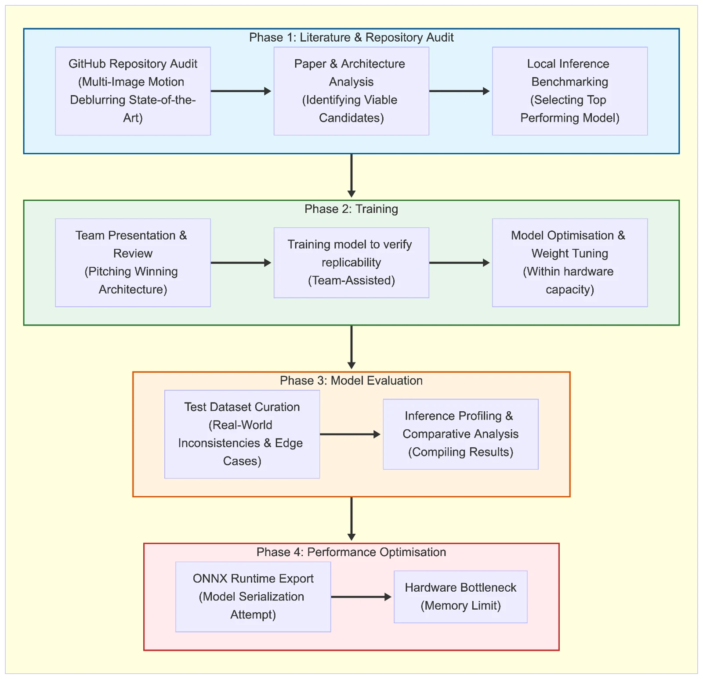
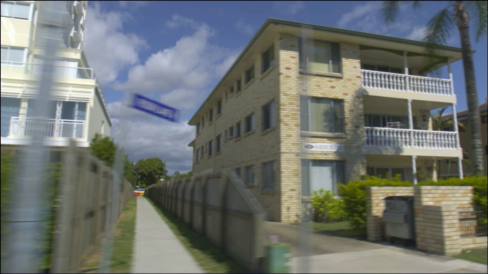

## The question

Fast movement in sports footage smears across a frame. At normal speed the eye barely notices, but in slow motion the blur becomes obvious. Sony's Advanced Technology team already used a deblurring model. My job was to find out whether newer research could do better, and whether it could ever run in something close to real time.

## How I approached it

<figure class="diagram"><figcaption>The four phases, from literature audit to performance optimisation.</figcaption></figure>

**1. Audit.** I went through 72 open-source repositories for multi-image deblurring and the papers behind them. Then I narrowed them down, first to 34 published after 2020, then to a shortlist of CNN and Vision Transformer models. I judged them on dependency health, how well they suited high-speed sport, and quality versus speed.

**2. Replicate.** For each shortlisted model, I first reproduced the authors' own results to check it actually worked, then ran it on the team's footage. That footage had no sharp "ground truth" frames, so standard scores like PSNR and SSIM weren't possible. I compared the models side by side on visual quality and inference speed instead.

**3. Train.** I presented the results, and the team picked the leading model. I then retrained it locally to prove the results could be reproduced: 600,000 iterations, with checkpoints every 50,000 to see how quickly it converged. The learning rate had to be cut to a quarter to fit our hardware.

**4. Optimise.** Inference on a full HD frame took about 3 seconds. I exported the model to ONNX and benchmarked different runtimes. Full HD overflowed GPU memory, so these runs used 960×540.

| Inference method | Time per frame | Throughput |
| --- | --- | --- |
| PyTorch (full HD) | 2.92 s | 0.34 fps |
| ONNX Runtime, CPU | 16.85 s | 0.06 fps |
| ONNX Runtime, CUDA | 0.93 s | 1.07 fps |
| ONNX Runtime, TensorRT | 0.59 s | **1.71 fps** |

<figure><figcaption>Before: a lightly blurred test frame.</figcaption></figure>
<figure><figcaption>After: the same frame through the model with ONNX Runtime and TensorRT.</figcaption></figure>

That's roughly a **5× increase in throughput** (402%), though at half the resolution, so it isn't a like-for-like comparison. Getting all the way to real time would take more work on model size and hardware.

## What came out of it

<blockquote>
“For Sony, the end result is a significant piece of research that will help kick-start further development.”
<cite>Project manager, Sony Europe</cite></blockquote>

I presented the findings to the wider team in a technical talk, along with a write-up of the model's quirks and the hardware limits I hit. It gave the team a clear starting point for the next phase of development.
