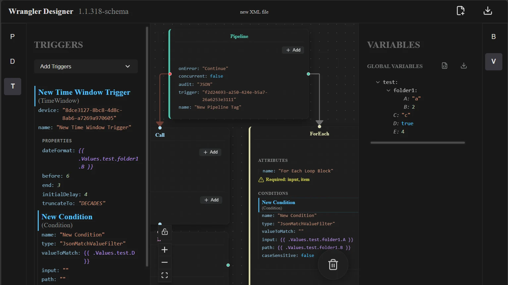
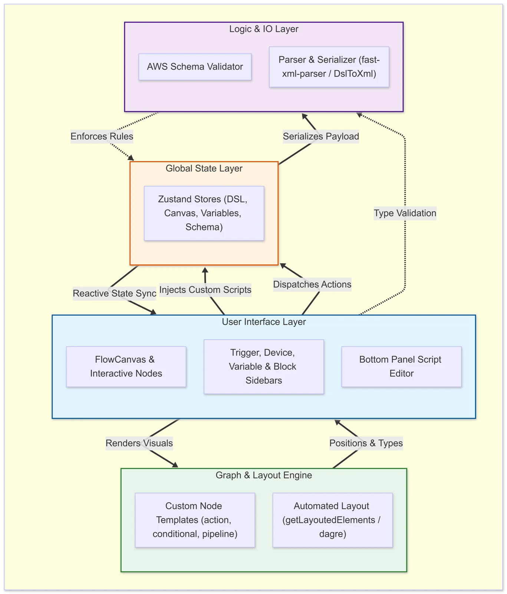

## The problem

Wrangler is a service Sony uses across its sports and media solutions. It has two halves: the **Core**, a Java engine, and the **Pipeline**, an XML blueprint that tells the Core what to do, step by step.

Writing those pipelines by hand was the bottleneck. XML is easy to break with a typo or a schema violation, there's nothing linking a variable to the places it's used, and every time the Core changed, someone had to update the XML manually. It was slow, hard to scale, and new people needed a lot of context before they could touch it.

## What I built

I started with a blank page and a loose idea that "something visual" might help. Working with my project manager and a QA engineer, I turned that into Wrangler Designer: a drag-and-drop canvas where you build a pipeline out of nodes, and the tool makes sure it's valid as you go.

<figure><figcaption>The workspace: triggers and conditions on the left, the pipeline canvas in the middle, global variables on the right.</figcaption></figure>

- **Schema-driven from the start.** On launch it fetches the latest schema from AWS, and every node, field and dropdown is generated from it. You can hot-swap to an older schema version to match an older Core. If you build a pipeline in the tool, it can't be incompatible.
- **Import and validate.** Existing XML pipelines and JSON variable files can be imported. Anything that breaks the schema is flagged with a clear message.
- **One source of truth.** The canvas, the sidebars and a code editor panel all read from and write to the same Zustand stores, so a change in one place shows up everywhere.
- **Safe renames.** Rename a variable and it finds every reference and offers to update them.
- **Auto-layout.** DagreJS arranges the graph so dense pipelines stay readable.
- **Export.** Production-ready XML and JSON, packaged client-side, ready for the Core.

## Decisions I'm glad I made

**Zustand over Redux or React Context.** Pipelines can get deeply nested. Context would have meant re-rendering large parts of the tree, and Redux felt heavy for what we needed. Zustand's small hook-based stores avoided prop-drilling and kept the canvas fast.

**Keeping the schema logic out of the UI.**

<figure class="diagram"><figcaption>How it fits together: the logic and I/O layer validates everything before it reaches the Zustand stores the UI reads from.</figcaption></figure>
 I put parsing and validation in its own logic and I/O layer between the interface and the files. That made it possible to change requirements late, which happened a lot, without rewriting components.

## Impact

Building a pipeline went from **hours to minutes**, and onboarding friction was close to gone. People could focus on the logic of a pipeline instead of the formatting. I set the feature direction, ran the QA cycle through JIRA with our tester, and became the team's go-to person for the tool.

<blockquote>
“Her quick understanding enabled her to develop features for Wrangler Designer before being asked to do so, showing great foresight into meeting user needs.”
<cite>Project manager, Sony Europe</cite></blockquote>

